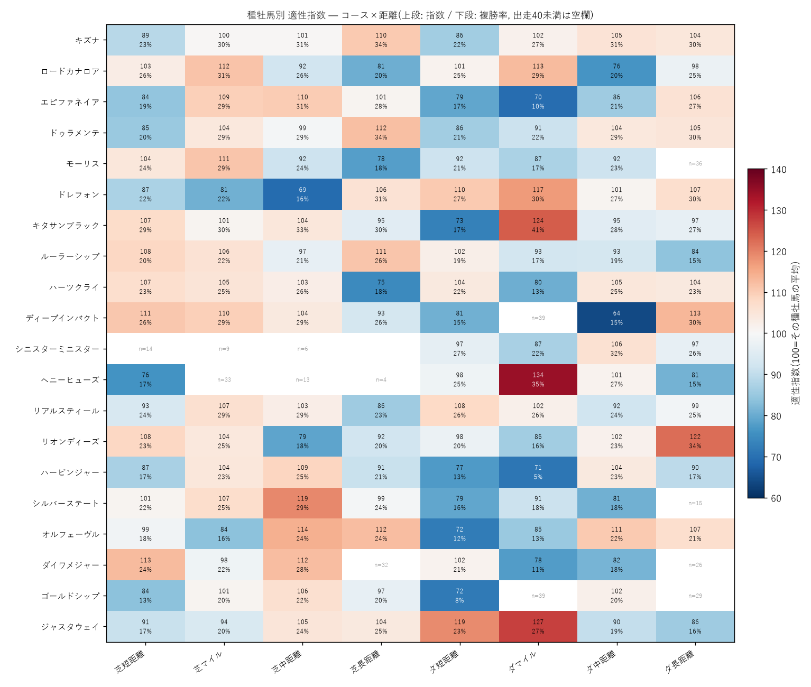
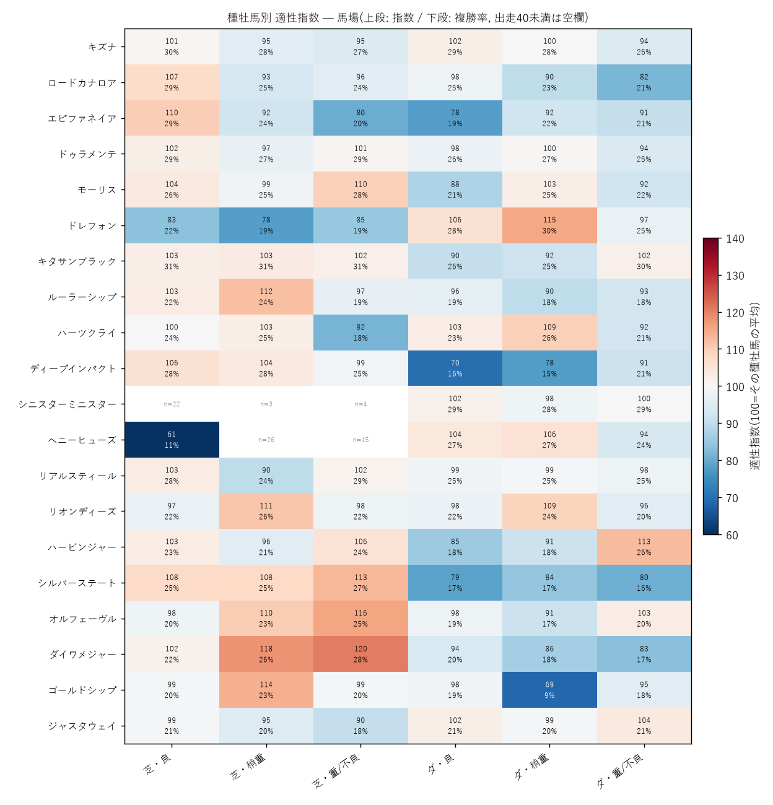
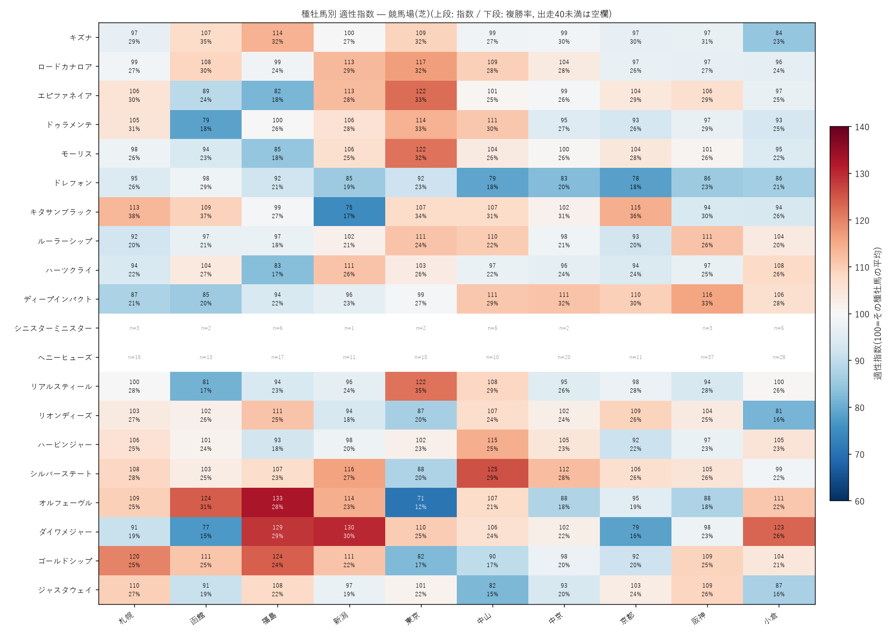
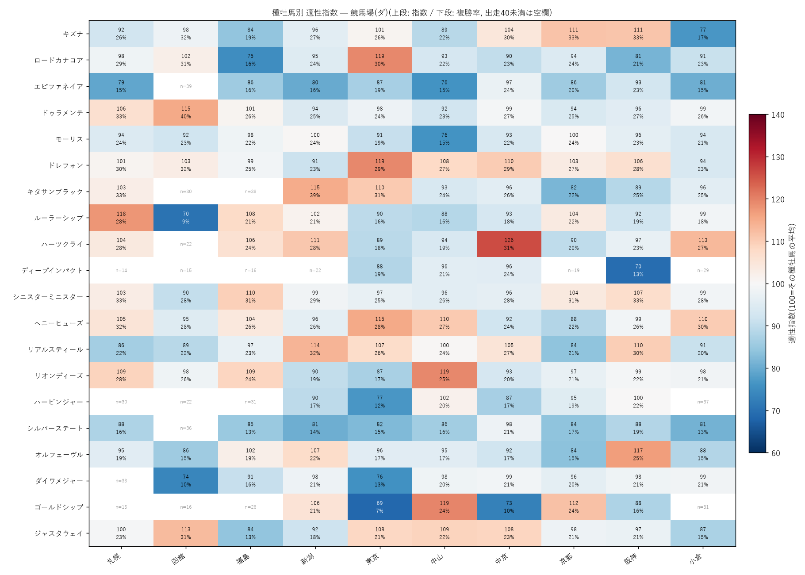
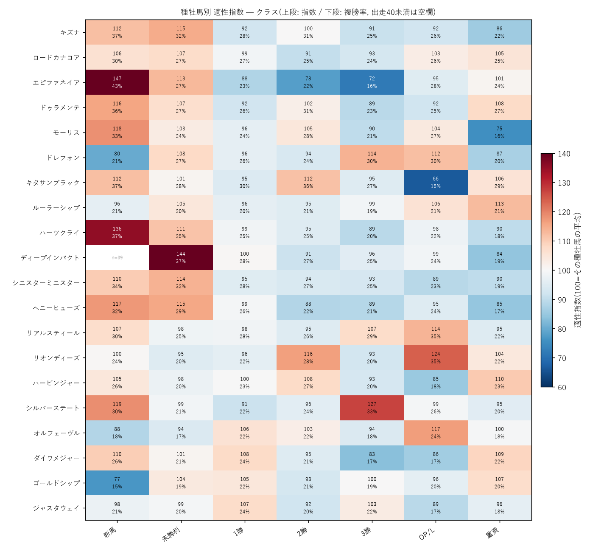
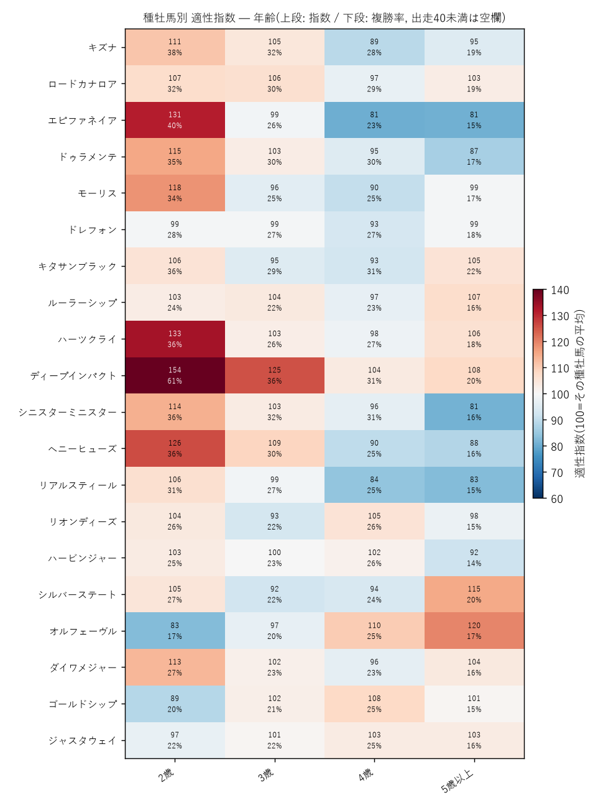
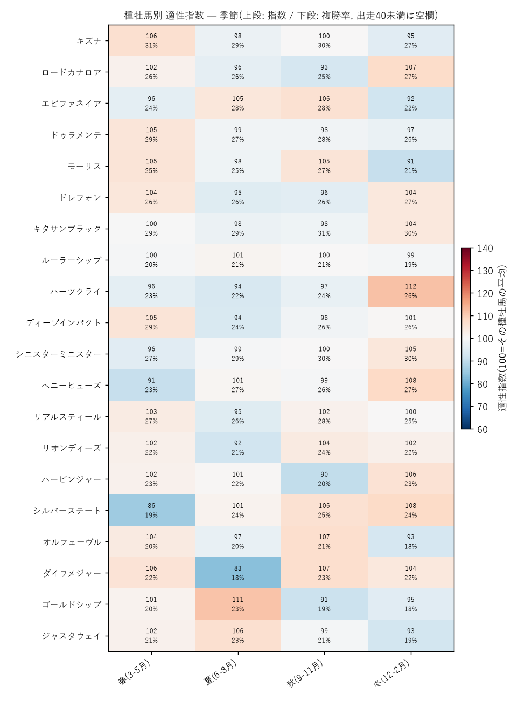

# 種牡馬 得意領域分析

- 対象: JRA平地 16,632 レース(2021/10/30〜2026/11/01)、指定20種牡馬の産駒の全出走
- 適性指数: 条件ごとの『複勝数 ÷ 期待複勝数(頭数と全馬の同条件実績から算出)』を、その種牡馬の全体値で割って100倍した値。100 = その種牡馬の平均どおり。サンプルの少ない条件は全体値へ縮約している
- 人気比: 勝利数 ÷ 単勝オッズから見た期待勝利数 ×100。100超 = 人気以上に勝っている
- 得意/苦手条件は出走80回以上の条件から選定

## 全体成績

| 種牡馬 | 出走 | 勝率 | 複勝率 | 単回収 | 複回収 | 人気比 | 傾向 |
|---|---:|---:|---:|---:|---:|---:|---|
| キズナ | 6,414 | 11.2% | 29.1% | 90.9% | 80.7% | 110.1 | 芝ダ兼用(芝出走65%)、ベストは芝長距離、早熟傾向 |
| ロードカナロア | 7,321 | 9.7% | 26.1% | 72.9% | 74.8% | 100.1 | 芝向き(芝出走59%)、ベストはダマイル、芝の道悪で割引、ダートの道悪で割引 |
| エピファネイア | 5,967 | 8.7% | 25.7% | 71.4% | 71.9% | 91.7 | 芝向き(芝出走77%)、ベストは芝中距離、芝の道悪で割引、ダートの道悪で上昇、早熟傾向 |
| ドゥラメンテ | 4,851 | 9.7% | 27.5% | 71.6% | 71.9% | 93.4 | 芝ダ兼用(芝出走63%)、ベストは芝長距離、早熟傾向 |
| モーリス | 5,066 | 9.2% | 24.7% | 81.2% | 74.5% | 99.0 | 芝向き(芝出走70%)、ベストは芝マイル、早熟傾向、牡馬・セン馬が優勢 |
| ドレフォン | 4,919 | 9.2% | 26.1% | 75.5% | 80.8% | 108.1 | ダート向き(芝出走26%)、ベストはダマイル |
| キタサンブラック | 3,115 | 11.6% | 29.8% | 75.5% | 75.2% | 102.5 | 芝向き(芝出走73%)、ベストは芝短距離、ダートの道悪で上昇 |
| ルーラーシップ | 5,055 | 6.3% | 20.4% | 67.4% | 70.5% | 92.8 | 芝向き(芝出走57%)、ベストは芝長距離 |
| ハーツクライ | 3,942 | 7.9% | 23.8% | 66.5% | 69.1% | 92.1 | 芝ダ兼用(芝出走69%)、ベストは芝短距離、芝の道悪で割引、ダートの道悪で割引、早熟傾向 |
| ディープインパクト | 3,239 | 9.0% | 26.4% | 71.4% | 70.8% | 92.4 | 芝向き(芝出走85%)、ベストは芝短距離、ダートの道悪で上昇 |
| シニスターミニスター | 2,855 | 10.7% | 28.8% | 100.6% | 90.3% | 121.6 | ダート向き(芝出走1%)、ベストはダ中距離、早熟傾向、牡馬・セン馬が優勢 |
| ヘニーヒューズ | 3,476 | 8.8% | 25.7% | 71.6% | 72.2% | 94.7 | ダート向き(芝出走5%)、ベストはダマイル、ダートの道悪で割引、早熟傾向 |
| リアルスティール | 3,014 | 9.7% | 26.6% | 92.9% | 78.2% | 108.3 | 芝ダ兼用(芝出走54%)、ベストはダ短距離、早熟傾向 |
| リオンディーズ | 3,741 | 7.2% | 22.3% | 65.2% | 73.1% | 96.9 | 芝ダ兼用(芝出走51%)、ベストは芝短距離、牡馬・セン馬が優勢 |
| ハービンジャー | 3,653 | 6.7% | 22.0% | 55.7% | 65.7% | 88.4 | 芝向き(芝出走81%)、ベストは芝中距離、ダートの道悪で上昇 |
| シルバーステート | 3,476 | 7.1% | 22.8% | 73.3% | 76.7% | 96.1 | 芝向き(芝出走72%)、ベストは芝中距離、牝馬が優勢 |
| オルフェーヴル | 3,320 | 6.7% | 19.8% | 90.2% | 73.2% | 107.9 | 芝ダ兼用(芝出走56%)、ベストは芝中距離、芝の道悪で上昇、晩成傾向 |
| ダイワメジャー | 3,196 | 6.8% | 21.6% | 70.3% | 71.2% | 91.0 | 芝向き(芝出走61%)、ベストは芝短距離、芝の道悪で上昇、ダートの道悪で割引 |
| ゴールドシップ | 3,696 | 5.8% | 20.1% | 58.7% | 67.5% | 94.7 | 芝向き(芝出走84%)、ベストは芝中距離 |
| ジャスタウェイ | 3,115 | 7.1% | 21.1% | 76.9% | 76.1% | 103.4 | 芝ダ兼用(芝出走49%)、ベストはダマイル |

## ヒートマップ

### コース×距離

### 馬場

### 競馬場(芝)

### 競馬場(ダ)

### クラス

### 年齢

### 季節

## 種牡馬別の詳細

### キズナ

**傾向**: 芝ダ兼用(芝出走65%)、ベストは芝長距離、早熟傾向

**得意条件**

| 次元 | 条件 | 出走 | 勝率 | 複勝率 | 適性指数 | 人気比 | 単回収 | 複回収 |
|---|---|---:|---:|---:|---:|---:|---:|---:|
| クラス | 未勝利 | 1712 | 12.9% | 31.7% | **115** | 116 | 110% | 92% |
| 競馬場(芝) | 福島 | 248 | 13.7% | 32.3% | **114** | 132 | 142% | 101% |
| クラス | 新馬 | 442 | 14.9% | 36.9% | **112** | 112 | 86% | 75% |
| 競馬場(ダ) | 京都 | 356 | 11.2% | 32.9% | **111** | 100 | 128% | 83% |
| 競馬場(ダ) | 阪神 | 460 | 13.3% | 33.0% | **111** | 113 | 68% | 89% |
| 年齢 | 2歳 | 861 | 15.2% | 37.7% | **111** | 116 | 112% | 97% |

**苦手条件**

| 次元 | 条件 | 出走 | 勝率 | 複勝率 | 適性指数 | 人気比 | 単回収 | 複回収 |
|---|---|---:|---:|---:|---:|---:|---:|---:|
| 競馬場(ダ) | 小倉 | 140 | 8.6% | 17.1% | **77** | 110 | 56% | 50% |
| 競馬場(ダ) | 福島 | 81 | 6.2% | 18.5% | **84** | 76 | 38% | 58% |
| 競馬場(芝) | 小倉 | 374 | 7.8% | 22.7% | **84** | 81 | 45% | 57% |
| クラス | 重賞 | 606 | 6.9% | 21.9% | **86** | 95 | 70% | 67% |

### ロードカナロア

**傾向**: 芝向き(芝出走59%)、ベストはダマイル、芝の道悪で割引、ダートの道悪で割引

**得意条件**

| 次元 | 条件 | 出走 | 勝率 | 複勝率 | 適性指数 | 人気比 | 単回収 | 複回収 |
|---|---|---:|---:|---:|---:|---:|---:|---:|
| 競馬場(ダ) | 東京 | 501 | 11.4% | 29.5% | **119** | 117 | 81% | 79% |
| 競馬場(芝) | 東京 | 686 | 10.5% | 31.8% | **117** | 85 | 50% | 81% |
| 競馬場(芝) | 新潟 | 282 | 11.7% | 28.7% | **113** | 124 | 118% | 96% |
| コース×距離 | ダマイル | 225 | 11.1% | 28.9% | **113** | 109 | 84% | 72% |
| コース×距離 | 芝マイル | 1850 | 11.5% | 30.6% | **112** | 97 | 61% | 77% |
| 競馬場(芝) | 中山 | 518 | 10.0% | 28.4% | **109** | 91 | 67% | 69% |

**苦手条件**

| 次元 | 条件 | 出走 | 勝率 | 複勝率 | 適性指数 | 人気比 | 単回収 | 複回収 |
|---|---|---:|---:|---:|---:|---:|---:|---:|
| 競馬場(ダ) | 福島 | 180 | 7.8% | 16.1% | **75** | 106 | 127% | 57% |
| コース×距離 | ダ中距離 | 1016 | 7.0% | 20.4% | **76** | 85 | 76% | 67% |
| コース×距離 | 芝長距離 | 91 | 4.4% | 19.8% | **81** | 48 | 28% | 45% |
| 競馬場(ダ) | 阪神 | 518 | 6.2% | 20.7% | **81** | 76 | 67% | 76% |

### エピファネイア

**傾向**: 芝向き(芝出走77%)、ベストは芝中距離、芝の道悪で割引、ダートの道悪で上昇、早熟傾向

**得意条件**

| 次元 | 条件 | 出走 | 勝率 | 複勝率 | 適性指数 | 人気比 | 単回収 | 複回収 |
|---|---|---:|---:|---:|---:|---:|---:|---:|
| クラス | 新馬 | 503 | 15.5% | 42.5% | **147** | 115 | 93% | 106% |
| 年齢 | 2歳 | 966 | 15.2% | 39.5% | **131** | 111 | 96% | 90% |
| 競馬場(芝) | 東京 | 766 | 12.3% | 32.9% | **122** | 101 | 102% | 71% |
| クラス | 未勝利 | 2019 | 9.7% | 26.9% | **113** | 98 | 72% | 76% |
| 競馬場(芝) | 新潟 | 417 | 10.3% | 28.1% | **113** | 105 | 102% | 74% |
| コース×距離 | 芝中距離 | 1389 | 10.4% | 30.6% | **110** | 93 | 70% | 77% |

**苦手条件**

| 次元 | 条件 | 出走 | 勝率 | 複勝率 | 適性指数 | 人気比 | 単回収 | 複回収 |
|---|---|---:|---:|---:|---:|---:|---:|---:|
| コース×距離 | ダマイル | 82 | 3.7% | 9.8% | **70** | 72 | 28% | 22% |
| クラス | 3勝 | 371 | 4.3% | 16.4% | **72** | 67 | 45% | 54% |
| 競馬場(ダ) | 中山 | 159 | 4.4% | 15.1% | **76** | 64 | 20% | 73% |
| クラス | 2勝 | 665 | 8.0% | 21.8% | **78** | 88 | 54% | 58% |

### ドゥラメンテ

**傾向**: 芝ダ兼用(芝出走63%)、ベストは芝長距離、早熟傾向

**得意条件**

| 次元 | 条件 | 出走 | 勝率 | 複勝率 | 適性指数 | 人気比 | 単回収 | 複回収 |
|---|---|---:|---:|---:|---:|---:|---:|---:|
| クラス | 新馬 | 290 | 14.1% | 35.5% | **116** | 105 | 75% | 76% |
| 年齢 | 2歳 | 486 | 13.2% | 35.4% | **115** | 94 | 84% | 75% |
| 競馬場(芝) | 東京 | 560 | 12.9% | 33.4% | **114** | 116 | 77% | 80% |
| コース×距離 | 芝長距離 | 352 | 13.4% | 34.1% | **112** | 123 | 89% | 86% |
| 競馬場(芝) | 中山 | 407 | 8.4% | 30.0% | **111** | 77 | 114% | 77% |
| クラス | 重賞 | 326 | 9.8% | 27.0% | **108** | 105 | 105% | 85% |

**苦手条件**

| 次元 | 条件 | 出走 | 勝率 | 複勝率 | 適性指数 | 人気比 | 単回収 | 複回収 |
|---|---|---:|---:|---:|---:|---:|---:|---:|
| 競馬場(芝) | 函館 | 89 | 6.7% | 18.0% | **79** | 94 | 65% | 44% |
| コース×距離 | 芝短距離 | 388 | 7.0% | 19.8% | **85** | 100 | 80% | 67% |
| コース×距離 | ダ短距離 | 554 | 7.4% | 20.8% | **86** | 96 | 99% | 77% |
| 年齢 | 5歳以上 | 1044 | 4.1% | 16.7% | **87** | 72 | 90% | 67% |

### モーリス

**傾向**: 芝向き(芝出走70%)、ベストは芝マイル、早熟傾向、牡馬・セン馬が優勢

**得意条件**

| 次元 | 条件 | 出走 | 勝率 | 複勝率 | 適性指数 | 人気比 | 単回収 | 複回収 |
|---|---|---:|---:|---:|---:|---:|---:|---:|
| 競馬場(芝) | 東京 | 594 | 11.3% | 31.8% | **122** | 101 | 133% | 96% |
| クラス | 新馬 | 411 | 13.9% | 32.6% | **118** | 110 | 108% | 85% |
| 年齢 | 2歳 | 823 | 13.9% | 33.9% | **118** | 105 | 90% | 78% |
| コース×距離 | 芝マイル | 1642 | 9.8% | 28.6% | **111** | 91 | 67% | 84% |
| 馬場 | 芝・重/不良 | 210 | 11.0% | 28.1% | **110** | 113 | 98% | 93% |
| 回り | 左 | 1820 | 9.6% | 26.5% | **107** | 99 | 90% | 81% |

**苦手条件**

| 次元 | 条件 | 出走 | 勝率 | 複勝率 | 適性指数 | 人気比 | 単回収 | 複回収 |
|---|---|---:|---:|---:|---:|---:|---:|---:|
| クラス | 重賞 | 342 | 7.0% | 16.1% | **75** | 99 | 57% | 53% |
| 競馬場(ダ) | 中山 | 191 | 8.4% | 15.2% | **76** | 106 | 104% | 49% |
| コース×距離 | 芝長距離 | 127 | 7.1% | 18.1% | **78** | 108 | 63% | 46% |
| 競馬場(芝) | 福島 | 222 | 8.1% | 18.5% | **85** | 106 | 79% | 65% |

### ドレフォン

**傾向**: ダート向き(芝出走26%)、ベストはダマイル

**得意条件**

| 次元 | 条件 | 出走 | 勝率 | 複勝率 | 適性指数 | 人気比 | 単回収 | 複回収 |
|---|---|---:|---:|---:|---:|---:|---:|---:|
| 競馬場(ダ) | 東京 | 668 | 10.9% | 29.3% | **119** | 111 | 71% | 83% |
| コース×距離 | ダマイル | 315 | 12.1% | 29.8% | **117** | 118 | 98% | 87% |
| 馬場 | ダ・稍重 | 694 | 11.5% | 30.3% | **115** | 121 | 77% | 88% |
| クラス | 3勝 | 280 | 11.4% | 29.6% | **114** | 146 | 103% | 102% |
| クラス | OP/L | 230 | 11.7% | 30.4% | **112** | 134 | 127% | 89% |
| コース×距離 | ダ短距離 | 1585 | 10.2% | 27.4% | **110** | 118 | 93% | 83% |

**苦手条件**

| 次元 | 条件 | 出走 | 勝率 | 複勝率 | 適性指数 | 人気比 | 単回収 | 複回収 |
|---|---|---:|---:|---:|---:|---:|---:|---:|
| コース×距離 | 芝中距離 | 167 | 4.8% | 16.2% | **69** | 86 | 52% | 55% |
| 馬場 | 芝・稍重 | 187 | 4.8% | 18.7% | **78** | 65 | 28% | 55% |
| 競馬場(芝) | 京都 | 132 | 3.0% | 18.2% | **78** | 63 | 54% | 99% |
| 競馬場(芝) | 中山 | 164 | 7.9% | 18.3% | **79** | 100 | 58% | 56% |

### キタサンブラック

**傾向**: 芝向き(芝出走73%)、ベストは芝短距離、ダートの道悪で上昇

**得意条件**

| 次元 | 条件 | 出走 | 勝率 | 複勝率 | 適性指数 | 人気比 | 単回収 | 複回収 |
|---|---|---:|---:|---:|---:|---:|---:|---:|
| 競馬場(芝) | 京都 | 348 | 12.4% | 36.2% | **115** | 105 | 81% | 91% |
| 競馬場(芝) | 札幌 | 120 | 14.2% | 37.5% | **113** | 100 | 148% | 112% |
| クラス | 新馬 | 314 | 14.0% | 36.9% | **112** | 92 | 57% | 75% |
| クラス | 2勝 | 335 | 15.2% | 36.4% | **112** | 134 | 105% | 90% |
| 競馬場(ダ) | 東京 | 119 | 13.4% | 31.1% | **110** | 146 | 77% | 66% |
| 競馬場(芝) | 函館 | 93 | 12.9% | 36.6% | **109** | 101 | 82% | 86% |

**苦手条件**

| 次元 | 条件 | 出走 | 勝率 | 複勝率 | 適性指数 | 人気比 | 単回収 | 複回収 |
|---|---|---:|---:|---:|---:|---:|---:|---:|
| クラス | OP/L | 134 | 6.7% | 14.9% | **66** | 80 | 59% | 46% |
| コース×距離 | ダ短距離 | 209 | 7.7% | 17.2% | **73** | 101 | 46% | 58% |
| 競馬場(芝) | 新潟 | 161 | 6.2% | 17.4% | **75** | 65 | 29% | 42% |
| 競馬場(ダ) | 京都 | 127 | 7.1% | 22.0% | **82** | 81 | 48% | 54% |

### ルーラーシップ

**傾向**: 芝向き(芝出走57%)、ベストは芝長距離

**得意条件**

| 次元 | 条件 | 出走 | 勝率 | 複勝率 | 適性指数 | 人気比 | 単回収 | 複回収 |
|---|---|---:|---:|---:|---:|---:|---:|---:|
| 競馬場(ダ) | 札幌 | 82 | 8.5% | 28.0% | **118** | 155 | 95% | 84% |
| クラス | 重賞 | 270 | 5.6% | 21.1% | **113** | 78 | 33% | 68% |
| 馬場 | 芝・稍重 | 440 | 9.1% | 23.9% | **112** | 112 | 80% | 80% |
| 競馬場(芝) | 東京 | 464 | 7.1% | 24.1% | **111** | 90 | 48% | 68% |
| 競馬場(芝) | 阪神 | 413 | 9.2% | 25.9% | **111** | 114 | 84% | 69% |
| コース×距離 | 芝長距離 | 337 | 6.2% | 25.5% | **111** | 75 | 41% | 73% |

**苦手条件**

| 次元 | 条件 | 出走 | 勝率 | 複勝率 | 適性指数 | 人気比 | 単回収 | 複回収 |
|---|---|---:|---:|---:|---:|---:|---:|---:|
| コース×距離 | ダ長距離 | 133 | 5.3% | 15.0% | **84** | 112 | 49% | 50% |
| 競馬場(ダ) | 中山 | 331 | 5.1% | 16.3% | **88** | 95 | 47% | 56% |
| 競馬場(ダ) | 東京 | 353 | 5.1% | 16.1% | **90** | 109 | 44% | 61% |
| 馬場 | ダ・稍重 | 426 | 2.3% | 17.6% | **90** | 38 | 18% | 66% |

### ハーツクライ

**傾向**: 芝ダ兼用(芝出走69%)、ベストは芝短距離、芝の道悪で割引、ダートの道悪で割引、早熟傾向

**得意条件**

| 次元 | 条件 | 出走 | 勝率 | 複勝率 | 適性指数 | 人気比 | 単回収 | 複回収 |
|---|---|---:|---:|---:|---:|---:|---:|---:|
| クラス | 新馬 | 161 | 13.0% | 37.3% | **136** | 87 | 54% | 76% |
| 年齢 | 2歳 | 292 | 13.0% | 36.3% | **133** | 83 | 65% | 72% |
| 競馬場(ダ) | 中京 | 209 | 10.5% | 31.1% | **126** | 112 | 57% | 86% |
| 季節 | 冬(12-2月) | 1072 | 8.2% | 26.1% | **112** | 97 | 73% | 71% |
| クラス | 未勝利 | 748 | 9.8% | 24.6% | **111** | 94 | 78% | 63% |
| 競馬場(芝) | 新潟 | 212 | 9.0% | 25.9% | **111** | 95 | 37% | 62% |

**苦手条件**

| 次元 | 条件 | 出走 | 勝率 | 複勝率 | 適性指数 | 人気比 | 単回収 | 複回収 |
|---|---|---:|---:|---:|---:|---:|---:|---:|
| コース×距離 | 芝長距離 | 434 | 6.5% | 18.4% | **75** | 84 | 46% | 69% |
| コース×距離 | ダマイル | 83 | 3.6% | 13.3% | **80** | 57 | 153% | 38% |
| 馬場 | 芝・重/不良 | 174 | 6.9% | 18.4% | **82** | 83 | 77% | 46% |
| 競馬場(芝) | 福島 | 162 | 4.3% | 16.7% | **83** | 57 | 35% | 80% |

### ディープインパクト

**傾向**: 芝向き(芝出走85%)、ベストは芝短距離、ダートの道悪で上昇

**得意条件**

| 次元 | 条件 | 出走 | 勝率 | 複勝率 | 適性指数 | 人気比 | 単回収 | 複回収 |
|---|---|---:|---:|---:|---:|---:|---:|---:|
| クラス | 未勝利 | 250 | 14.8% | 37.2% | **144** | 92 | 77% | 69% |
| 年齢 | 3歳 | 540 | 15.6% | 36.5% | **125** | 99 | 80% | 72% |
| 競馬場(芝) | 阪神 | 508 | 11.6% | 33.1% | **116** | 95 | 74% | 74% |
| 競馬場(芝) | 中京 | 357 | 11.2% | 31.9% | **111** | 102 | 71% | 86% |
| 競馬場(芝) | 中山 | 330 | 8.5% | 29.1% | **111** | 84 | 79% | 84% |
| コース×距離 | 芝短距離 | 368 | 7.6% | 26.1% | **111** | 95 | 78% | 87% |

**苦手条件**

| 次元 | 条件 | 出走 | 勝率 | 複勝率 | 適性指数 | 人気比 | 単回収 | 複回収 |
|---|---|---:|---:|---:|---:|---:|---:|---:|
| コース×距離 | ダ中距離 | 288 | 6.9% | 14.6% | **64** | 100 | 59% | 48% |
| 競馬場(ダ) | 阪神 | 113 | 8.0% | 13.3% | **70** | 114 | 60% | 51% |
| 馬場 | ダ・良 | 334 | 6.9% | 15.9% | **70** | 100 | 81% | 58% |
| 馬場 | ダ・稍重 | 80 | 5.0% | 15.0% | **78** | 70 | 37% | 30% |

### シニスターミニスター

**傾向**: ダート向き(芝出走1%)、ベストはダ中距離、早熟傾向、牡馬・セン馬が優勢

**得意条件**

| 次元 | 条件 | 出走 | 勝率 | 複勝率 | 適性指数 | 人気比 | 単回収 | 複回収 |
|---|---|---:|---:|---:|---:|---:|---:|---:|
| 年齢 | 2歳 | 298 | 13.1% | 35.9% | **114** | 126 | 112% | 111% |
| クラス | 未勝利 | 788 | 11.9% | 32.2% | **114** | 123 | 105% | 90% |
| クラス | 新馬 | 179 | 11.7% | 33.5% | **110** | 130 | 101% | 101% |
| 競馬場(ダ) | 福島 | 189 | 12.7% | 31.2% | **110** | 146 | 162% | 100% |
| 競馬場(ダ) | 阪神 | 486 | 12.1% | 32.5% | **107** | 135 | 100% | 106% |
| コース×距離 | ダ中距離 | 1457 | 12.6% | 31.8% | **106** | 128 | 102% | 96% |

**苦手条件**

| 次元 | 条件 | 出走 | 勝率 | 複勝率 | 適性指数 | 人気比 | 単回収 | 複回収 |
|---|---|---:|---:|---:|---:|---:|---:|---:|
| 年齢 | 5歳以上 | 602 | 5.5% | 15.8% | **81** | 110 | 80% | 76% |
| 性別 | 牝 | 1036 | 8.6% | 21.9% | **86** | 132 | 100% | 72% |
| コース×距離 | ダマイル | 151 | 6.6% | 21.9% | **87** | 106 | 121% | 96% |
| クラス | OP/L | 154 | 7.1% | 23.4% | **89** | 82 | 62% | 62% |

### ヘニーヒューズ

**傾向**: ダート向き(芝出走5%)、ベストはダマイル、ダートの道悪で割引、早熟傾向

**得意条件**

| 次元 | 条件 | 出走 | 勝率 | 複勝率 | 適性指数 | 人気比 | 単回収 | 複回収 |
|---|---|---:|---:|---:|---:|---:|---:|---:|
| コース×距離 | ダマイル | 342 | 9.9% | 35.4% | **134** | 90 | 38% | 91% |
| 年齢 | 2歳 | 430 | 13.3% | 35.6% | **126** | 106 | 101% | 91% |
| クラス | 新馬 | 212 | 13.2% | 32.1% | **117** | 113 | 84% | 68% |
| クラス | 未勝利 | 817 | 10.4% | 29.5% | **115** | 97 | 72% | 80% |
| 競馬場(ダ) | 東京 | 696 | 9.2% | 28.4% | **115** | 94 | 62% | 76% |
| 競馬場(ダ) | 中山 | 562 | 10.7% | 27.4% | **110** | 100 | 54% | 57% |

**苦手条件**

| 次元 | 条件 | 出走 | 勝率 | 複勝率 | 適性指数 | 人気比 | 単回収 | 複回収 |
|---|---|---:|---:|---:|---:|---:|---:|---:|
| 馬場 | 芝・良 | 136 | 1.5% | 11.0% | **61** | 36 | 10% | 29% |
| コース×距離 | 芝短距離 | 127 | 3.1% | 16.5% | **76** | 52 | 36% | 44% |
| クラス | 重賞 | 88 | 6.8% | 17.0% | **85** | 119 | 83% | 76% |
| クラス | 2勝 | 691 | 7.2% | 22.3% | **88** | 94 | 78% | 67% |

### リアルスティール

**傾向**: 芝ダ兼用(芝出走54%)、ベストはダ短距離、早熟傾向

**得意条件**

| 次元 | 条件 | 出走 | 勝率 | 複勝率 | 適性指数 | 人気比 | 単回収 | 複回収 |
|---|---|---:|---:|---:|---:|---:|---:|---:|
| 競馬場(芝) | 東京 | 269 | 13.4% | 34.9% | **122** | 123 | 117% | 93% |
| 競馬場(ダ) | 新潟 | 98 | 14.3% | 31.6% | **114** | 153 | 83% | 121% |
| クラス | OP/L | 85 | 8.2% | 35.3% | **114** | 71 | 82% | 97% |
| 回り | 左 | 1041 | 11.3% | 28.8% | **110** | 121 | 94% | 80% |
| 競馬場(ダ) | 阪神 | 185 | 12.4% | 29.7% | **110** | 132 | 61% | 97% |
| 競馬場(芝) | 中山 | 211 | 12.3% | 28.9% | **108** | 125 | 177% | 102% |

**苦手条件**

| 次元 | 条件 | 出走 | 勝率 | 複勝率 | 適性指数 | 人気比 | 単回収 | 複回収 |
|---|---|---:|---:|---:|---:|---:|---:|---:|
| 年齢 | 5歳以上 | 254 | 3.9% | 14.6% | **83** | 83 | 58% | 58% |
| 競馬場(ダ) | 京都 | 249 | 5.2% | 21.3% | **84** | 65 | 94% | 74% |
| 年齢 | 4歳 | 576 | 8.2% | 24.7% | **84** | 92 | 84% | 69% |
| コース×距離 | 芝長距離 | 96 | 10.4% | 22.9% | **86** | 121 | 146% | 78% |

### リオンディーズ

**傾向**: 芝ダ兼用(芝出走51%)、ベストは芝短距離、牡馬・セン馬が優勢

**得意条件**

| 次元 | 条件 | 出走 | 勝率 | 複勝率 | 適性指数 | 人気比 | 単回収 | 複回収 |
|---|---|---:|---:|---:|---:|---:|---:|---:|
| クラス | OP/L | 81 | 16.0% | 34.6% | **124** | 176 | 128% | 96% |
| 競馬場(ダ) | 中山 | 308 | 9.4% | 25.3% | **119** | 121 | 94% | 78% |
| クラス | 2勝 | 467 | 9.2% | 27.6% | **116** | 106 | 56% | 75% |
| 競馬場(芝) | 福島 | 151 | 9.9% | 25.2% | **111** | 129 | 78% | 91% |
| 馬場 | 芝・稍重 | 301 | 6.6% | 25.9% | **111** | 85 | 51% | 84% |
| 競馬場(芝) | 京都 | 243 | 8.2% | 25.5% | **109** | 108 | 132% | 94% |

**苦手条件**

| 次元 | 条件 | 出走 | 勝率 | 複勝率 | 適性指数 | 人気比 | 単回収 | 複回収 |
|---|---|---:|---:|---:|---:|---:|---:|---:|
| コース×距離 | 芝中距離 | 343 | 5.5% | 18.1% | **79** | 83 | 27% | 71% |
| 競馬場(芝) | 小倉 | 190 | 4.7% | 15.8% | **81** | 67 | 60% | 63% |
| コース×距離 | ダマイル | 119 | 5.0% | 16.0% | **86** | 72 | 17% | 60% |
| 競馬場(芝) | 東京 | 248 | 6.9% | 19.8% | **87** | 88 | 45% | 50% |

### ハービンジャー

**傾向**: 芝向き(芝出走81%)、ベストは芝中距離、ダートの道悪で上昇

**得意条件**

| 次元 | 条件 | 出走 | 勝率 | 複勝率 | 適性指数 | 人気比 | 単回収 | 複回収 |
|---|---|---:|---:|---:|---:|---:|---:|---:|
| 競馬場(芝) | 中山 | 388 | 7.2% | 24.7% | **115** | 92 | 71% | 64% |
| 馬場 | ダ・重/不良 | 116 | 6.0% | 25.9% | **113** | 92 | 89% | 89% |
| クラス | 重賞 | 204 | 7.4% | 22.5% | **110** | 97 | 44% | 63% |
| コース×距離 | 芝中距離 | 1169 | 8.5% | 24.9% | **109** | 103 | 60% | 70% |
| クラス | 2勝 | 404 | 9.9% | 27.0% | **108** | 102 | 64% | 66% |
| 競馬場(芝) | 札幌 | 204 | 6.4% | 24.5% | **106** | 86 | 73% | 75% |

**苦手条件**

| 次元 | 条件 | 出走 | 勝率 | 複勝率 | 適性指数 | 人気比 | 単回収 | 複回収 |
|---|---|---:|---:|---:|---:|---:|---:|---:|
| 競馬場(ダ) | 東京 | 109 | 2.8% | 11.9% | **77** | 51 | 48% | 45% |
| コース×距離 | ダ短距離 | 127 | 3.1% | 12.6% | **77** | 56 | 45% | 42% |
| クラス | OP/L | 107 | 5.6% | 17.8% | **85** | 74 | 63% | 50% |
| 馬場 | ダ・良 | 447 | 4.5% | 17.7% | **85** | 65 | 38% | 47% |

### シルバーステート

**傾向**: 芝向き(芝出走72%)、ベストは芝中距離、牝馬が優勢

**得意条件**

| 次元 | 条件 | 出走 | 勝率 | 複勝率 | 適性指数 | 人気比 | 単回収 | 複回収 |
|---|---|---:|---:|---:|---:|---:|---:|---:|
| クラス | 3勝 | 97 | 12.4% | 33.0% | **127** | 149 | 119% | 107% |
| 競馬場(芝) | 中山 | 391 | 9.5% | 29.2% | **125** | 115 | 77% | 96% |
| コース×距離 | 芝中距離 | 605 | 9.6% | 29.4% | **119** | 106 | 65% | 103% |
| クラス | 新馬 | 354 | 10.2% | 29.7% | **119** | 115 | 98% | 85% |
| 競馬場(芝) | 新潟 | 215 | 5.1% | 26.5% | **116** | 60 | 69% | 83% |
| 年齢 | 5歳以上 | 419 | 4.5% | 19.6% | **115** | 83 | 51% | 86% |

**苦手条件**

| 次元 | 条件 | 出走 | 勝率 | 複勝率 | 適性指数 | 人気比 | 単回収 | 複回収 |
|---|---|---:|---:|---:|---:|---:|---:|---:|
| 馬場 | ダ・良 | 629 | 5.9% | 16.9% | **79** | 94 | 63% | 59% |
| コース×距離 | ダ短距離 | 513 | 5.1% | 16.2% | **79** | 82 | 50% | 59% |
| 馬場 | ダ・重/不良 | 159 | 3.8% | 15.7% | **80** | 70 | 21% | 45% |
| コース×距離 | ダ中距離 | 381 | 6.6% | 17.8% | **81** | 111 | 109% | 64% |

### オルフェーヴル

**傾向**: 芝ダ兼用(芝出走56%)、ベストは芝中距離、芝の道悪で上昇、晩成傾向

**得意条件**

| 次元 | 条件 | 出走 | 勝率 | 複勝率 | 適性指数 | 人気比 | 単回収 | 複回収 |
|---|---|---:|---:|---:|---:|---:|---:|---:|
| 競馬場(芝) | 福島 | 156 | 10.9% | 27.6% | **133** | 164 | 92% | 88% |
| 競馬場(芝) | 函館 | 89 | 10.1% | 31.5% | **124** | 111 | 88% | 76% |
| 年齢 | 5歳以上 | 976 | 4.6% | 17.4% | **120** | 101 | 68% | 73% |
| 競馬場(ダ) | 阪神 | 263 | 8.4% | 24.7% | **117** | 99 | 61% | 86% |
| クラス | OP/L | 148 | 12.8% | 24.3% | **117** | 184 | 87% | 64% |
| 馬場 | 芝・重/不良 | 123 | 6.5% | 25.2% | **116** | 85 | 48% | 92% |

**苦手条件**

| 次元 | 条件 | 出走 | 勝率 | 複勝率 | 適性指数 | 人気比 | 単回収 | 複回収 |
|---|---|---:|---:|---:|---:|---:|---:|---:|
| 競馬場(芝) | 東京 | 204 | 3.9% | 12.3% | **71** | 81 | 50% | 42% |
| コース×距離 | ダ短距離 | 425 | 4.5% | 12.2% | **72** | 116 | 94% | 69% |
| 年齢 | 2歳 | 418 | 5.3% | 17.5% | **83** | 76 | 59% | 54% |
| コース×距離 | 芝マイル | 552 | 6.2% | 16.5% | **84** | 112 | 133% | 68% |

### ダイワメジャー

**傾向**: 芝向き(芝出走61%)、ベストは芝短距離、芝の道悪で上昇、ダートの道悪で割引

**得意条件**

| 次元 | 条件 | 出走 | 勝率 | 複勝率 | 適性指数 | 人気比 | 単回収 | 複回収 |
|---|---|---:|---:|---:|---:|---:|---:|---:|
| 競馬場(芝) | 新潟 | 151 | 12.6% | 29.8% | **130** | 135 | 83% | 70% |
| 競馬場(芝) | 福島 | 179 | 7.8% | 29.1% | **129** | 86 | 70% | 72% |
| 競馬場(芝) | 小倉 | 246 | 8.1% | 26.4% | **123** | 100 | 82% | 95% |
| 馬場 | 芝・重/不良 | 145 | 7.6% | 28.3% | **120** | 91 | 52% | 101% |
| 馬場 | 芝・稍重 | 300 | 6.0% | 26.0% | **118** | 84 | 49% | 86% |
| 年齢 | 2歳 | 462 | 8.2% | 27.3% | **113** | 81 | 73% | 70% |

**苦手条件**

| 次元 | 条件 | 出走 | 勝率 | 複勝率 | 適性指数 | 人気比 | 単回収 | 複回収 |
|---|---|---:|---:|---:|---:|---:|---:|---:|
| 競馬場(ダ) | 東京 | 175 | 2.9% | 13.1% | **76** | 57 | 23% | 44% |
| 競馬場(芝) | 函館 | 115 | 5.2% | 14.8% | **77** | 71 | 33% | 82% |
| 競馬場(芝) | 京都 | 195 | 4.6% | 15.9% | **79** | 79 | 68% | 75% |
| コース×距離 | ダ中距離 | 489 | 5.5% | 17.8% | **82** | 79 | 45% | 52% |

### ゴールドシップ

**傾向**: 芝向き(芝出走84%)、ベストは芝中距離

**得意条件**

| 次元 | 条件 | 出走 | 勝率 | 複勝率 | 適性指数 | 人気比 | 単回収 | 複回収 |
|---|---|---:|---:|---:|---:|---:|---:|---:|
| 競馬場(芝) | 福島 | 351 | 8.3% | 23.9% | **124** | 112 | 78% | 65% |
| 競馬場(芝) | 札幌 | 236 | 8.1% | 25.4% | **120** | 103 | 61% | 101% |
| 競馬場(ダ) | 中山 | 104 | 7.7% | 24.0% | **119** | 125 | 85% | 68% |
| 馬場 | 芝・稍重 | 516 | 7.8% | 23.1% | **114** | 106 | 71% | 62% |
| 季節 | 夏(6-8月) | 923 | 6.4% | 23.1% | **111** | 99 | 75% | 81% |
| 競馬場(芝) | 新潟 | 325 | 5.5% | 22.2% | **111** | 100 | 91% | 76% |

**苦手条件**

| 次元 | 条件 | 出走 | 勝率 | 複勝率 | 適性指数 | 人気比 | 単回収 | 複回収 |
|---|---|---:|---:|---:|---:|---:|---:|---:|
| 馬場 | ダ・稍重 | 108 | 5.6% | 9.3% | **69** | 131 | 90% | 41% |
| クラス | 新馬 | 259 | 3.9% | 15.4% | **77** | 87 | 58% | 54% |
| 競馬場(芝) | 東京 | 496 | 4.0% | 17.1% | **82** | 92 | 50% | 65% |
| コース×距離 | 芝短距離 | 111 | 2.7% | 12.6% | **84** | 64 | 45% | 48% |

### ジャスタウェイ

**傾向**: 芝ダ兼用(芝出走49%)、ベストはダマイル

**得意条件**

| 次元 | 条件 | 出走 | 勝率 | 複勝率 | 適性指数 | 人気比 | 単回収 | 複回収 |
|---|---|---:|---:|---:|---:|---:|---:|---:|
| コース×距離 | ダマイル | 142 | 11.3% | 27.5% | **127** | 145 | 121% | 80% |
| コース×距離 | ダ短距離 | 498 | 6.8% | 23.3% | **119** | 100 | 73% | 98% |
| 頭数 | 〜10頭 | 373 | 11.0% | 35.9% | **110** | 99 | 80% | 78% |
| 競馬場(芝) | 札幌 | 88 | 8.0% | 27.3% | **110** | 102 | 49% | 76% |
| 競馬場(ダ) | 中山 | 278 | 7.6% | 21.6% | **109** | 112 | 106% | 79% |
| 競馬場(芝) | 阪神 | 219 | 8.7% | 25.6% | **109** | 132 | 57% | 115% |

**苦手条件**

| 次元 | 条件 | 出走 | 勝率 | 複勝率 | 適性指数 | 人気比 | 単回収 | 複回収 |
|---|---|---:|---:|---:|---:|---:|---:|---:|
| 競馬場(芝) | 中山 | 207 | 7.2% | 15.5% | **82** | 112 | 68% | 53% |
| コース×距離 | ダ長距離 | 107 | 2.8% | 15.9% | **86** | 47 | 29% | 64% |
| 競馬場(芝) | 小倉 | 147 | 5.4% | 16.3% | **87** | 85 | 70% | 48% |
| クラス | OP/L | 124 | 7.3% | 16.9% | **89** | 132 | 262% | 91% |
